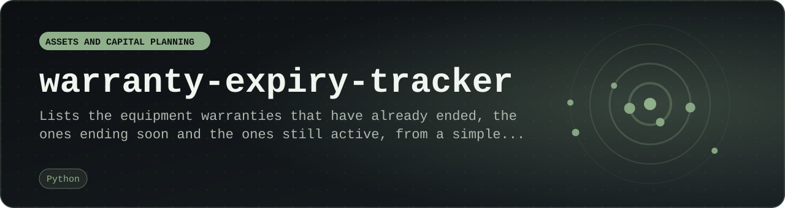
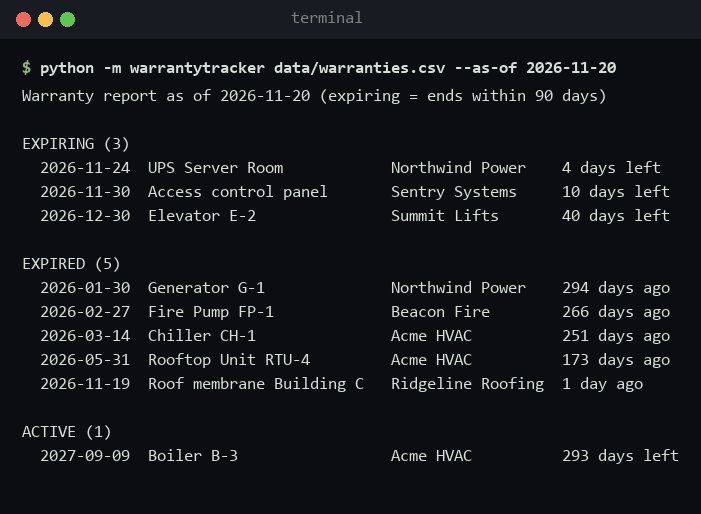

<p align="center"></p>

# warranty-expiry-tracker

Lists the equipment warranties that have already ended, the ones ending soon and the ones still active, from a simple CSV of start dates and warranty lengths.



## What it is for

A warranty is only worth something if you claim before it ends. Facility teams often find out a chiller or elevator warranty expired last month, after paying for a repair the vendor would have covered. This tool reads a list of assets with a start date and a length in months, works out the last covered day and tells a facility manager what to inspect and claim on first.

## Install

```
git clone https://github.com/yassine2med/warranty-expiry-tracker
cd warranty-expiry-tracker && pip install -r requirements.txt
```

## How to use

| I want to | Command |
|---|---|
| Report on a warranty list | `PYTHONPATH=src python -m warrantytracker data/warranties.csv` |
| Report as of a fixed date (repeatable output) | `--as-of 2026-11-20` |
| Change what counts as expiring soon (default 90 days) | `--within 30` |
| Save the expiring and expired rows to a CSV | `--out due.csv` |
| Show help | `PYTHONPATH=src python -m warrantytracker --help` |

The CSV has `asset,vendor,start_date,months` with dates as YYYY-MM-DD (see `data/warranties.csv`, invented data). Exit codes: 0 on success, 1 for a missing file, bad dates or a bad column, 2 for bad arguments.

Example:

```
PYTHONPATH=src python -m warrantytracker data/warranties.csv --as-of 2026-11-20
```

Output:

```
Warranty report as of 2026-11-20 (expiring = ends within 90 days)

EXPIRING (3)
  2026-11-24  UPS Server Room            Northwind Power    4 days left
  2026-11-30  Access control panel       Sentry Systems     10 days left
  2026-12-30  Elevator E-2               Summit Lifts       40 days left

EXPIRED (5)
  2026-01-30  Generator G-1              Northwind Power    294 days ago
  2026-02-27  Fire Pump FP-1             Beacon Fire        266 days ago
  2026-03-14  Chiller CH-1               Acme HVAC          251 days ago
  2026-05-31  Rooftop Unit RTU-4         Acme HVAC          173 days ago
  2026-11-19  Roof membrane Building C   Ridgeline Roofing  1 day ago

ACTIVE (1)
  2027-09-09  Boiler B-3                 Acme HVAC          293 days left
```

Run the tests with `python -m pytest -q`.

## How it works

1. The last covered day is the start date plus the number of months, minus one day. When the target month is shorter, the date is clamped (a 1 month warranty from Jan 31 ends Feb 27).
2. A warranty is expired when its end date is before the report date.
3. It is expiring when it ends within the `--within` window, and active otherwise.
4. Each group is sorted by end date, so the most urgent line comes first.

## Limits

- It does not read the terms. Coverage limits, exclusions and notice periods are not tracked.
- Only one warranty per row. Extended warranties need their own row.
- It prints a report. It does not send reminders by itself, but a scheduler can run it and mail the output.

## License

MIT. Yassine Emhamed, 2026.
